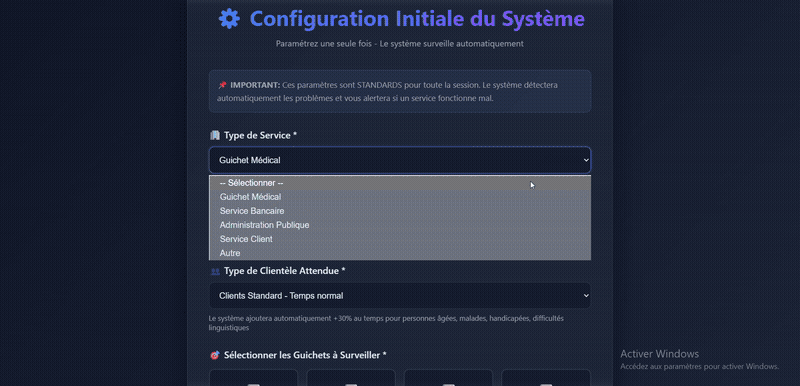
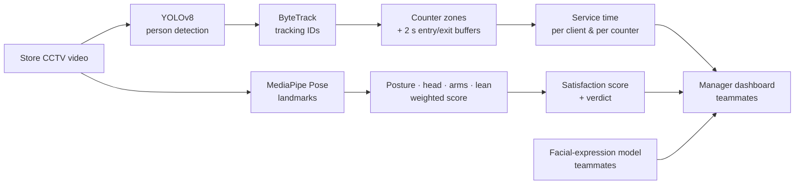
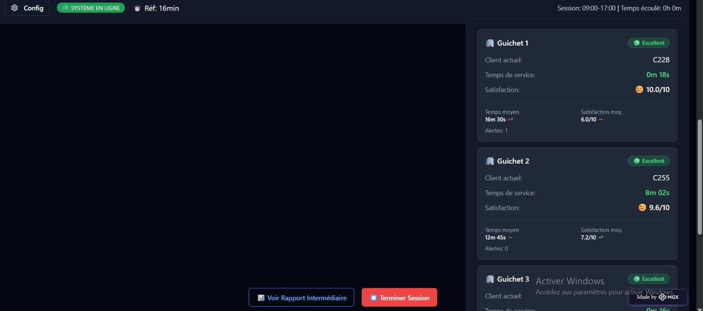
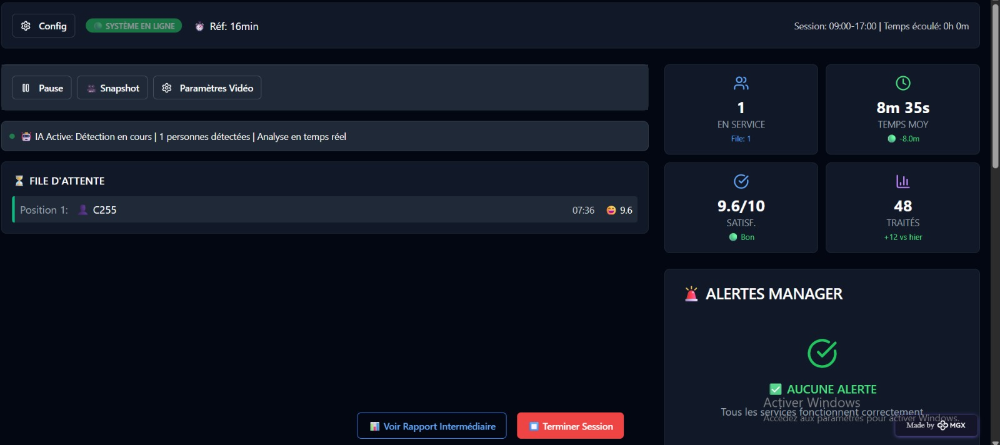
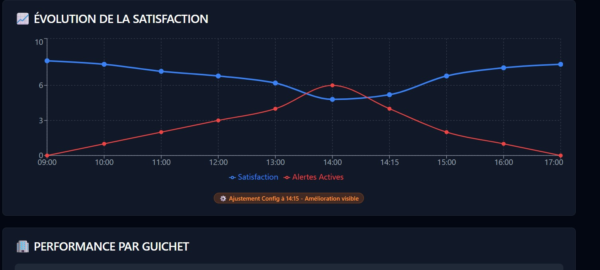
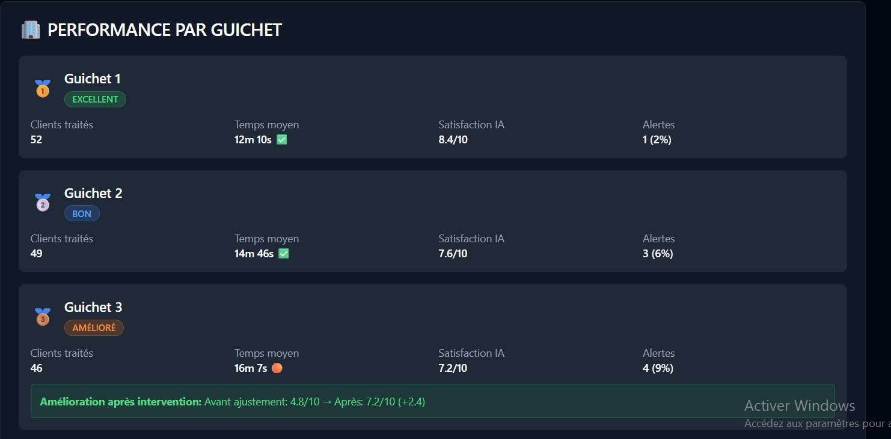
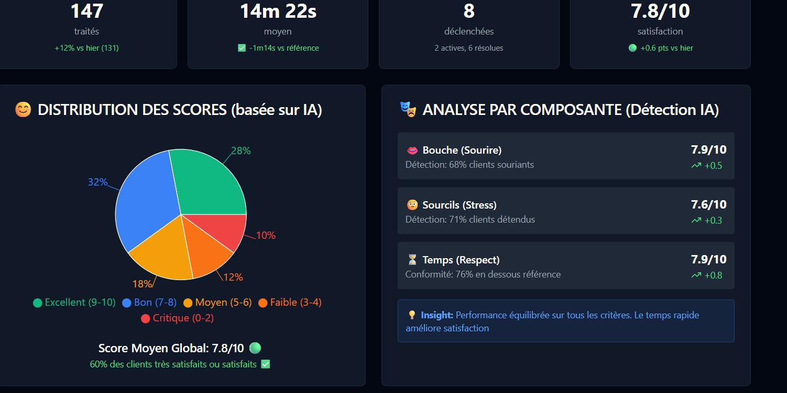
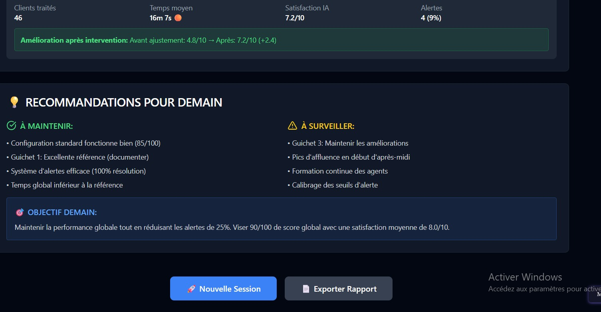

# Counter Efficiency AI — GAICA 2025

> Computer-vision system that measures **service time at each counter** and estimates **customer satisfaction from body language**, using whatever camera the store already has.

Built during the **GAICA 2025** hackathon, in the **Counter Efficiency Award** track: *the most relevant solution for the average waiting time at the counter.*



*Manager dashboard (built by teammates, demo data).*

---

## The problem

Stores and banks want to know how long clients wait at each counter and whether they leave satisfied, but they can't place a dedicated camera next to every cashier. The system has to work with the **existing CCTV camera, whatever its angle**, and turn the footage into numbers a manager can act on.

## What it does

| Module | How it works |
|---|---|
| **Service-time tracking** (`src/service_time_tracker.py`) | The user draws one zone per counter on the first frame. **YOLOv8** detects people and **ByteTrack** follows each one with a stable ID. When a client stays in a zone for more than 2 s, a service starts; when they leave for more than 2 s, it ends. Outputs live timers, the **average service time per counter**, and a CSV of every service. |
| **Satisfaction from body language** (`src/satisfaction_analyzer.py`) | **MediaPipe Pose** extracts body landmarks about once per second. A weighted, rule-based score (0–100) combines shoulder posture (35 %), head agitation (25 %), arm openness (20 %) and body lean (20 %), smoothed over time. Outputs an annotated video, a satisfaction curve and a verdict: *satisfied / neutral / unsatisfied*. |

### Design choices
- **Entry and exit buffers (2 s):** a client walking past the counter is not counted as a service.
- **Size filter:** small, far-away detections are ignored, so people in the background don't trigger a service.
- **Several people in a zone:** the person closest to the bottom edge of the zone is kept as the one being served.
- **Video clock, not computer clock:** durations are computed from frame numbers, so they stay correct whether the analysis runs faster or slower than real time.
- **Lightweight pose analysis:** frame sampling, reduced resolution and the light MediaPipe model keep it fast on a CPU.

## Pipeline



## Screenshots

> The dashboard was built by teammates. It shows **demo data**: no real store data was available during the hackathon.

| Live counters | Live dashboard |
|---|---|
|  |  |

| Satisfaction over the day | Performance per counter |
|---|---|
|  |  |

| Score distribution | Recommendations |
|---|---|
|  |  |

## Run it

```bash
pip install -r requirements.txt

# Service time per counter (draw the counter zones on the first frame with the mouse, press q to stop)
cd src
python service_time_tracker.py path/to/video.mp4

# Satisfaction from body language
python satisfaction_analyzer.py path/to/video.mp4
```

The YOLOv8 weights (`yolov8n.pt`) download automatically on the first run. A GPU is used when available.

## Tech stack

Python · YOLOv8 (Ultralytics) · ByteTrack (Supervision) · MediaPipe Pose · OpenCV · PyTorch · NumPy · Matplotlib

## Team & my contribution

Built as a team during GAICA 2025. **My part:** the service-time tracking module and the body-language satisfaction analysis in `src/`.

My teammates built the facial-expression model and the manager dashboard; their code is not included in this repository.
